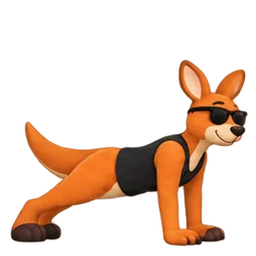

# 🦘 Torvik — Real-Time Exercise Tracking with Computer Vision

> [!NOTE]
> **This project is currently under development.**


[](https://github.com/felipemarcioli/Torvik/actions/workflows/check.yml)

A web application that uses your camera to **track exercise repetitions, time supported holds, and provide movement feedback directly in the browser**.

Torvik combines MediaPipe pose estimation with exercise-specific rules, a mobile-first interface, and a kangaroo mascot that demonstrates each movement.

**[License](#-license) · [Live Demo](https://torvik-ai.vercel.app/) · [Getting Started](#-getting-started) · [Repository Structure](#-repository-structure) · [Contact](#-contact)**

---

## 📸 Demo

**Try Torvik: [torvik-ai.vercel.app](https://torvik-ai.vercel.app/)**

The interface and written exercise guidance support **11 languages**: Brazilian Portuguese, English, Spanish, French, German, Italian, Japanese, Simplified Chinese, Korean, Hindi, and Arabic. Voice guidance uses the selected language when a compatible device voice is available. You can train without an account; camera permission is required to track movement.

### Exercise Previews

These are the animated mascot previews used inside the app, rather than recordings of camera tracking.

<table>
  <tr>
    <th>Squat</th>
    <th>Push-up</th>
    <th>Jumping Jack</th>
  </tr>
  <tr>
    <td></td>
    <td></td>
    <td></td>
  </tr>
</table>

### How to Use

1. Open the app and sign in or choose to continue without an account.
2. Select an exercise and read its preparation, equipment, and camera instructions.
3. Allow camera access and hold the starting position until the app recognizes it.
4. Follow the countdown, perform the movement, and monitor the visual or available voice feedback.
5. Pause or finish the workout to review the session report.
6. Choose **Salvar sessão** to save the summary locally, or export the results.

Use a stable camera and good lighting. Follow the camera angle recommended for each exercise; a single angle does not work equally well for every movement.

## 💡 About the Project

Torvik explores how computer vision can make exercise tracking accessible through a browser, using a phone camera or webcam.

The project connects several areas of software development: pose estimation, geometry, temporal state machines, browser media APIs, responsive interfaces, and local data storage. The goal is to turn a stream of estimated body landmarks into understandable feedback and useful session records.

Its results describe the application's programmed criteria. They are not a clinical assessment, a guarantee of safe technique, or a replacement for qualified guidance.

### Key Highlights

- **30 exercises:** organized into upper body, legs and glutes, core, and cardio.
- **Local pose processing:** camera frames are analyzed in the browser.
- **Repetition and hold tracking:** counts completed movement cycles or time within the configured hold criteria.
- **Guided sessions:** preparation, countdown, pause, resume, and tracking-loss handling.
- **Movement feedback:** exercise-specific messages based on visible landmarks and temporal rules.
- **11 languages:** translated interface, exercise instructions, and movement feedback, with automatic device-language detection and a persistent manual selection in Settings.
- **Arabic RTL support:** reading direction and layouts adapt when Arabic is selected.
- **Voice guidance:** optional speech with basic/full modes and volume controls, when a compatible voice is available for the selected language.
- **Animated demonstrations:** exercise previews featuring Torvik, with still images for reduced-motion preferences.
- **Session reports:** active duration, repetitions or hold time, feedback occurrences, and side-specific results where supported.
- **Progress history:** local records, activity calendar, charts, filters, and compatible-session comparisons.
- **Exports:** JSON history, session CSV, and printable reports that can be saved as PDF through the browser.
- **Optional accounts:** Supabase authentication, with local workout history separated by account.

## 🏋️ Exercise Catalog

| Group | Count | Exercises |
| --- | ---: | --- |
| Upper body | 8 | Push-up, floor press, biceps curl, triceps kickback, lateral raise, shoulder press, front raise, bent-over row |
| Legs and glutes | 8 | Squat, lunge, reverse lunge, glute bridge, calf raise, Romanian deadlift, Bulgarian split squat, wall sit |
| Core | 7 | Sit-up, plank, side plank, dead bug, bird dog, lying leg raise, shoulder tap |
| Cardio | 7 | Jumping jack, mountain climber, high knees, butt kicks, skater, step jack, jump squat |

Plank, side plank, and wall sit use hold-time tracking. Other exercises use movement-cycle counting. Selected exercises track or alternate sides; the in-app instructions explain what counts as one repetition.

Some movements require equipment or a particular camera position. See the [catalog expansion documentation](docs/catalog-30.md) for measurement definitions and known limitations.

## 🧠 How the Tracking Works

### 1. Camera and Pose Estimation

The browser requests camera access and passes frames to **MediaPipe Pose**. The estimator returns body landmarks; Torvik checks whether the landmarks needed for the selected exercise are visible and usable.

The workout flow currently uses the legacy MediaPipe Pose adapter. A separate MediaPipe Tasks Vision adapter exists for experimental comparisons.

### 2. Geometric Measurements

Exercise analyzers calculate joint angles, relative distances, and alignment measures from the estimated landmarks. Measurements account for the video's dimensions; some distances are normalized against body segments.

Pose estimation is model-based, while **repetition counting and feedback use deterministic, versioned rules**. Torvik does not train its own pose model or use an LLM to judge exercise form.

### 3. Temporal State Machines

A repetition requires a recognized starting position, the exercise's movement phases, and a completed return or finish condition. Separate entry/exit thresholds and time-based confirmation help reduce counts caused by jitter.

Tracking loss, long gaps, and incomplete cycles are handled separately from completed repetitions. Hold-based exercises accumulate valid posture time rather than repetitions.

### 4. Session Reports and History

The session layer records completed events and active time. Reports retain rule and estimator versions, so history comparisons can account for compatibility.

A percentage shown in a report describes the proportion of evaluated repetitions that met the app's criteria; it is **not the model's measured accuracy**.

## 🛠️ Built With

| Area | Technologies |
| --- | --- |
| Language and UI | TypeScript, React 19 |
| Application framework | TanStack Start, TanStack Router |
| Styling and components | Tailwind CSS 4, Radix UI, Lucide |
| Pose estimation | MediaPipe Pose; experimental Tasks Vision adapter |
| Authentication | Supabase Auth |
| Local persistence | IndexedDB; localStorage for preferences |
| Voice | Browser Speech Synthesis API with compatible regional voices |
| Charts | Recharts |
| Tooling | Bun, Vite, Nitro, ESLint, Prettier |
| Testing and CI | Bun test, Playwright, GitHub Actions |
| Hosting | Vercel |

## 🚀 Getting Started

### Prerequisites

- **Node.js 22.23.3**, matching [`.node-version`](.node-version).
- **Bun 1.3.10**, matching [`package.json`](package.json).
- A browser with camera access and a working webcam or phone camera.
- An internet connection to load external model assets and fonts.

Camera access requires **HTTPS or localhost**. For testing on a phone, use an HTTPS preview.

### Installation & Execution

> [!IMPORTANT]
> The following local setup instructions are provided for technical evaluation only. They do not grant any license to reuse, redistribute, modify, or commercially deploy Torvik. See [LICENSE](LICENSE) and GitHub's Terms of Service.


1. **Clone the repository:**

   ```bash
   git clone https://github.com/felipemarcioli/Torvik.git
   cd Torvik
   ```

2. **Install the locked dependencies:**

   ```bash
   bun install --frozen-lockfile
   ```

3. **Start the development server:**

   ```bash
   bun run dev
   ```

4. Open the local URL printed by Vite.

Authentication is optional. Without Supabase environment variables, the app remains usable without an account.

### Optional Authentication Setup

To connect your own Supabase project, create `.env.local` in the repository root:

```dotenv
VITE_SUPABASE_URL=https://YOUR-PROJECT.supabase.co
VITE_SUPABASE_PUBLISHABLE_KEY=YOUR-PUBLISHABLE-KEY
```

Enable email/password authentication and configure the allowed redirect URLs for your local and deployed origins. Restart Vite after changing environment variables.

The repository's [`.env.example`](.env.example) contains the existing deployment's public client configuration. **Replace those values with your own project configuration for an independent deployment.** Never place a Supabase secret or `service_role` key in a `VITE_*` variable.

See [authentication setup](docs/authentication.md) for email-confirmation behavior, recovery flows, redirects, and account isolation.

## 🧪 Testing & Development

| Command | Purpose |
| --- | --- |
| `bun run dev` | Start the development server |
| `bun run typecheck` | Check application and test types |
| `bun run lint` | Run ESLint |
| `bun run test` | Run unit and integration tests |
| `bun run build` | Create a production build |
| `bun run check` | Run type checking, lint, unit tests, translation validation, and build |
| `bun run test:i18n` | Validate 11 translation catalogs and mocked voice integration |
| `bun run test:e2e:i18n` | Exercise 11 languages in desktop/mobile Chromium; save screenshots |
| `bun run test:e2e` | Run Playwright browser tests |

Install the browser before running end-to-end tests:

```bash
bunx playwright install chromium
bun run test:e2e
```

GitHub Actions runs validation on pull requests and pushes to `main`, including a Vercel-targeted build and a separate authentication test run.

Tests cover movement rules, session transitions, camera lifecycle, history, exports, authentication, and browser flows. Browser tests use a **synthetic camera and controlled estimator**; passing them does not establish real-world tracking accuracy.

### Internationalization

Supported languages are **Português (Brasil), English, Español, Français, Deutsch, Italiano, 日本語, 简体中文, 한국어, हिन्दी, and العربية**. Interface text and spoken exercise guidance use the same selected language. Voice can be disabled independently; if no compatible voice is installed, written guidance stays available without switching speech to another language.

The first visit matches `navigator.languages` (then `navigator.language`) against the supported languages, with English as fallback. **Settings → Language** offers automatic detection and native language names. Manual choices persist across reloads; switching languages also cancels stale speech. The workout camera/voice panel includes the same selector. Arabic changes the document direction to RTL without mirroring the camera.

`src/lib/i18n/` owns detection, formatting, preference persistence, and the React provider. `src/locales/<code>/translation.json` contains pretranslated UI and voice text. Validation compares catalog parity and translation keys extracted from the source, including dynamic camera/authentication errors and movement feedback. Portuguese natural-language keys also resolve legacy stored feedback identifiers; do not rename exercise IDs or stored feedback as part of translation work. Components subscribe with `useTranslation()` and display text through `translate`; the voice layer uses `translateVoice`, which refuses a fallback in another language.

To add a language, register its native name and regional speech code in `languages.ts`, import a complete JSON catalog in `index.ts`, and run the translation, voice, and browser tests. Preserve every interpolation variable. `bun scripts/audio-reference.ts` regenerates the seven reference phrases per language for human listening review. Automated tests validate API calls and text, not pronunciation or real playback. The dedicated mock-auth CI step also exercises login, registration, and recovery in every language.

The browser initializes locale preferences before mounting the interactive routes, keeping the SSR loading shell stable. A future Capacitor shell may pass `Device.getLanguageTag` through `LocaleProvider.nativeLanguage`; no native package is required by this web implementation. Preferences currently stay on this browser/device; account synchronization is not implemented.

### Experimental Pose Lab

The `/lab` route is available during development. It compares the legacy pose adapter and the Tasks Vision Worker adapter on a local video, reporting count error, tracking coverage, and processing latency.

For a dedicated evaluation build, use `VITE_ENABLE_POSE_LAB=true`. The lab is disabled by default in production, and its feature flag is not an access-control mechanism. Enabling it does not replace the workout engine.

## 📁 Repository Structure

| Path | Responsibility |
| --- | --- |
| [`src/routes/`](src/routes/) | App entry, root shell, and experimental lab route |
| [`src/components/torvik/`](src/components/torvik/) | Exercise discovery, workouts, reports, history, authentication, and settings |
| [`src/components/ui/`](src/components/ui/) | Reusable interface components |
| [`src/hooks/`](src/hooks/) | Workout lifecycle, navigation, authentication, history, and voice hooks |
| [`src/lib/exercises/`](src/lib/exercises/) | Exercise catalog, geometry, analyzers, temporal rules, and feedback |
| [`src/lib/camera.ts`](src/lib/camera.ts) | Camera acquisition, processing lifecycle, and cleanup |
| [`src/lib/mediapipe.ts`](src/lib/mediapipe.ts) | Legacy MediaPipe Pose adapter used during workouts |
| [`src/lib/pose/`](src/lib/pose/) | Shared pose interfaces, experimental Tasks Vision adapter, and evaluation tools |
| [`src/lib/session.ts`](src/lib/session.ts) | Session events, timing, and report data |
| [`src/lib/history.ts`](src/lib/history.ts) | Local session persistence |
| [`src/lib/history-export.ts`](src/lib/history-export.ts) | CSV export and printable reports |
| [`src/lib/voice/`](src/lib/voice/) | Speech queue, local voice selection, and workout announcements |
| [`public/exercise-previews/`](public/exercise-previews/) | Animated WebP previews, still images, and sprite sheets |
| [`tests/`](tests/) | Unit tests, fixtures, and Playwright scenarios |
| [`docs/`](docs/) | Technical notes, authentication, exercise rules, and validation records |
| [`scripts/`](scripts/) | Exercise-preview asset tooling |
| [`.github/workflows/check.yml`](.github/workflows/check.yml) | Continuous integration workflow |

## 🔒 Privacy & Data Storage

- **Camera frames and landmarks:** processed locally; the application does not upload them.
- **Saved workouts:** summaries are written to IndexedDB only when you choose to save a session.
- **Accounts:** optional authentication sends account information to Supabase. Signing in does not sync workouts to the cloud.
- **History separation:** accounts and guest mode use separate local history. This is not encryption against someone with access to the same browser profile.
- **External requests:** model assets and fonts are fetched from external services.
- **Voice:** uses a compatible browser/system voice. Some voices need an online service; availability and offline operation depend on the device. Missing voices leave written guidance available. Language and audio preferences are stored locally, independently of your account.
- **Backups:** browser storage can be cleared or evicted. Export important records before clearing data or changing devices.

Torvik does not currently guarantee offline operation.

## ⚠️ Current Limitations

Tracking depends on lighting, framing, camera angle, occlusion, movement speed, and device performance. A 2D pose estimate cannot reliably establish physical contact, applied load, muscle activation, or exercise safety.

The exercise rules have automated synthetic-data coverage, but real-movement calibration and validation across physical devices remain pending in the project's validation records. The app does not claim clinically validated measurements or a published accuracy benchmark.

Current scope also excludes cloud workout synchronization, social rankings, and a native mobile package. See [validation notes](docs/validation.md) for the evaluation protocol and [catalog limitations](docs/catalog-30.md) for exercise-specific details.

## 🚢 Deployment

For a Vercel-targeted build, run the following in a POSIX shell:

```bash
NITRO_PRESET=vercel bun run build
```

This builds the application; it does not publish it. Configure Node 22 and any required environment variables in your hosting environment, then test a preview before promoting it.

The project uses the official Vite, TanStack Start, React, Tailwind CSS, and Nitro plugins configured in [`vite.config.ts`](vite.config.ts). Confirm the connected production branch in the hosting dashboard.

## 🤝 Feedback & Contributions

Torvik is a proprietary, source-available portfolio project. The repository is public so its implementation can be reviewed, but it is **not open-source** and does not grant permission to reuse, modify, redistribute, or commercialize the code.

Bug reports and reproducible feedback are welcome through [Issues](https://github.com/felipemarcioli/Torvik/issues). Contributions and pull requests are **not currently solicited**; please contact the author before proposing code contributions.

When reporting a camera issue, include your device, browser, exercise, orientation, and reproduction steps. Do not include credentials or identifiable workout footage in a public issue.

## 📚 Documentation & Acknowledgments

- [Authentication and local account history](docs/authentication.md)
- [Exercise catalog expansion and measurement definitions](docs/catalog-30.md)
- [Earlier exercise expansion](docs/exercise-expansion.md)
- [Mobile interface notes](docs/mobile-interface.md)
- [Validation records and evaluation protocol](docs/validation.md)

See the [internationalization implementation and test report](docs/i18n-implementation-report.md) for translation review coverage, mocked TTS results, and pending physical-device and human listening checks.

Torvik uses MediaPipe's pretrained pose-estimation technology and the open-source libraries listed in [`package.json`](package.json).

## 📄 License

**© 2026 Felipe Marcioli. All Rights Reserved.** Torvik is proprietary, **source-available** software, not open-source.

The code is publicly visible for portfolio review and demonstration only. No permission is granted to reuse, modify, redistribute, sublicense, commercialize, or create derivative works without prior written authorization, except for rights provided by GitHub's Terms of Service and applicable law. Public GitHub repositories can still be forked under GitHub's platform terms; this notice does not disable that feature.

See the full [LICENSE](LICENSE). Third-party components retain their own licenses.

## 📞 Contact

**Felipe Marcioli**

- **Email:** [felipemmarcioli@gmail.com](mailto:felipemmarcioli@gmail.com)
- **GitHub:** [@felipemarcioli](https://github.com/felipemarcioli)
